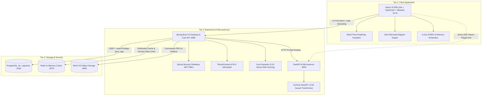

# GenZ AI — Architecture & Component Specifications

This document outlines the system context, component topology, and data flow of the GenZ AI student workspace and AI infrastructure.

---

## 1. System Context Diagram (3-Tier Topology)

The diagram below details the operational boundaries and network interactions across the frontend client, microservices, and persistence layers.

---

## 2. Core Subsystems & Components

### A. Authentication & Multi-Tenant Isolation
* **Stateless JWT**: Access tokens (24h) and Refresh tokens (7d) signed via HMAC-SHA256 (`jjwt`).
* **TenantContext**: User ID extracted from the authenticated `UserPrincipal` and propagated via `TenantContext` (`ThreadLocal<String>`).
* **Database RLS**: Every transactional connection sets `app.current_tenant`. PostgreSQL enforces `FORCE ROW LEVEL SECURITY`, preventing cross-tenant leakage even if application queries omit filters.
* **Least-Privilege Role**: Application connects as `genz_app` with `NOSUPERUSER NOBYPASSRLS`.

### B. MiniGPT Edge LLM & AI Microservice
* **17M Causal Transformer**: 6 decoder layers, 6 attention heads, 384 embedding dimensions, 512 block context, trained locally on consumer GPU (RTX 3050).
* **Custom BPE Tokenizer**: 16,384 vocabulary size trained on academic/technical corpora.
* **FastAPI Service**: Serves SSE streaming (`/api/minigpt/generate`), OpenAI-compatible `/v1/chat/completions`, and hardware telemetry (`/api/minigpt/status`).

### C. Documents & RAG Subsystem
* **ETL Pipeline**: PDF and text courseware ingestion, token budgeting, and chunk extraction.
* **Vector Store**: 768-dimensional embeddings indexed using `pgvector` HNSW cosine distance (`vector_store` table).
* **Grounded Citations**: Queries return source metadata including document name and exact chunk offsets.

### D. Study Planner & Cognitive Memory Engine
* **FullCalendar v6**: Month, week, and day agenda views for daily academic allocations.
* **FSRS v6 Scheduler**: Modern 3-component memory model (Stability, Retrievability, Difficulty) implemented via `ts-fsrs`, reducing review workload by 20–30% compared to legacy SM-2.
* **Pomodoro Focus Timer**: Interactive focus sessions with automated, idempotent `activity_log` recording upon 90% completion.

### E. Aptitude & Assessment Engine
* **Tracks**: Quantitative, Logical, Verbal, and Technical computer science test tracks.
* **Exam Modes**: Practice mode (instant feedback) and Timed Exam mode (server-synchronized countdown).
* **Explainability**: Step-by-step reasoning and AI-assisted wrong-answer explainers.

### F. Project Builder & System Architecture
* **Spring Initializr Scaffolding**: Configurable project generator producing one-line `curl` and Maven CLI bootstrap commands.
* **Draft 2020-12 Schema Validation**: Self-correction retry loop validating project blueprints. Offline template fallback for Full-stack web, AI/ML, and Mobile/Cloud domains.
* **React Flow Roadmap**: Interactive phase DAG with milestone checklists.
* **Viva Defense Simulator**: 0–10 server-side grading on correctness, completeness, and clarity with keyword-coverage offline heuristics.
