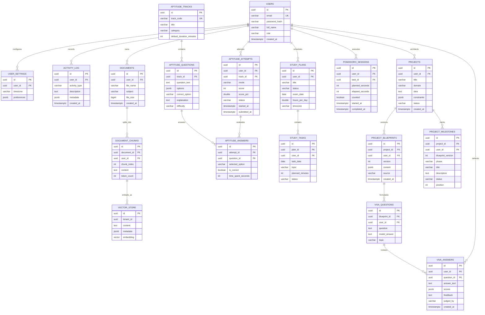

# GenZ AI — Database Schema & Entity-Relationship Specifications

This document defines the relational and vector database schemas derived directly from Flyway migrations (`V1` through `V7`).

---

## 1. Complete Entity-Relationship Diagram



---

## 2. Row-Level Security (RLS) Policy Specifications

All tenant-scoped tables are secured with `ENABLE ROW LEVEL SECURITY` and `FORCE ROW LEVEL SECURITY`.

### Isolation Pattern
```sql
CREATE POLICY <table_name>_tenant_policy ON <table_name>
    FOR ALL
    USING (user_id = NULLIF(current_setting('app.current_tenant', true), '')::uuid)
    WITH CHECK (user_id = NULLIF(current_setting('app.current_tenant', true), '')::uuid);

ALTER TABLE <table_name> FORCE ROW LEVEL SECURITY;
```

### Least-Privilege Role: `genz_app`
* Role creation flags: `NOSUPERUSER NOBYPASSRLS NOCREATEDB NOCREATEROLE`.
* Granted DML access (`SELECT`, `INSERT`, `UPDATE`, `DELETE`) on all domain tables.
* Explicitly denied access to Flyway internal metadata:
  ```sql
  REVOKE ALL ON TABLE flyway_schema_history FROM genz_app;
  ```
